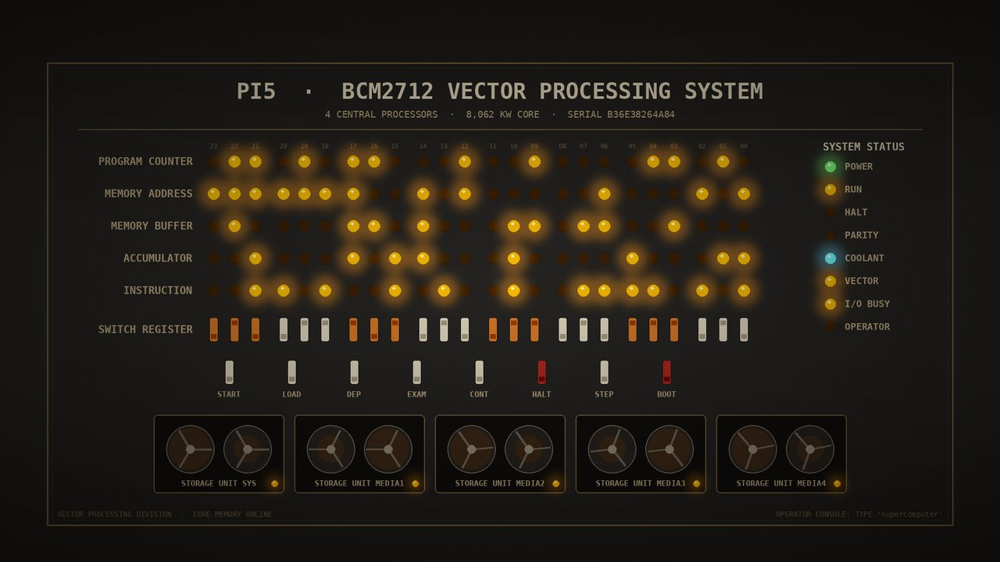

# supercomputer

**A retro mainframe operator console for your terminal.** Blinkenlights,
tape drives and a teletype operator log, all driven by what your machine
is really doing.

```
                    PI5 · BCM2712 VECTOR PROCESSING SYSTEM · SERIAL B36E38264A84
 UPTIME 2D 21H 24M      CORE MEMORY 8,062 MW    COOLANT  55.6 C                           19:20:32

╔═ CENTRAL PROCESSORS ════════════════════════════════════════════════════════════════════════════╗
║ CPU 0   ● · ● ●  · ● ● ·  ● ● · ●  · · ● ·  ● · · ●  · ● ● ·    46.0%                           ║
║ CPU 1   · · · ·  · · · ●  · · · ·  · · · ·  · · · ·  · · · ·     6.1%                           ║
║ CPU 2   · · · ●  · · · ·  · · · ·  · · · ·  · · ● ·  · · ● ·    11.7%                           ║
║ CPU 3   ● ● ● ●  ● · ● ●  ● ● ● ●  · ● ● ●  ● ● · ●  ● ● ● ●    88.2%                           ║
╚═════════════════════════════════════════════════════════════════════════════════════════════════╝
╔═ CORE STORAGE ══════════════════════════════════════════════════════════════════════════════════╗
║ MEM    ██████████████··························  35.8%  2.8G OF 7.9G                            ║
╚═════════════════════════════════════════════════════════════════════════════════════════════════╝
╔═ MASS STORAGE UNITS ════════════════════════════════════════════════════════════════════════════╗
║ SYS    R ● ● · ·   W · · · ·    ████················   22% OF 916.5G      4.2M/S                ║
║ MEDIA1 R · · · ·   W · · · ·    ████████████████····   82% OF   7.3T        0B/S                ║
║ MEDIA4 R ● ● ● ●   W · ● · ·    ██████··············   32% OF  10.9T    148.3M/S                ║
╚═════════════════════════════════════════════════════════════════════════════════════════════════╝
╔═ DATA LINK / SUBSYSTEMS ════════════════════════════════════════════════════════════════════════╗
║ RX ● · · ●  TX ● · · ·    ■ PLEX  ■ SMB  ■ XMIT  ■ VNC  ■ SSH  ■ TSNET                          ║
╚═════════════════════════════════════════════════════════════════════════════════════════════════╝
╔═ ACTIVE JOBS ═══════════════════════════════════════════════════════════════════════════════════╗
║ JOB  126290  CHROMIUM          · ● · ●  ● ● · ●  ● ● ● ●  ● ● ● ●     88.5%                     ║
║ JOB    1099  WAYVNC            · · · ·  · · · ·  · · ● ·  · · · ·      3.0%                     ║
╚═════════════════════════════════════════════════════════════════════════════════════════════════╝
╔═ OPERATOR LOG ══════════════════════════════════════════════════════════════════════════════════╗
║ 19:20:25  PI5 COLD START COMPLETE. ALL UNITS NOMINAL.                                           ║
║ 19:20:31  STORAGE UNIT MEDIA4: CHANNEL ACTIVE  R 148.3M/S  W 1.2M/S                             ║
║ 19:20:35  VECTOR PIPELINE AT 65% — ALL PROCESSORS ENGAGED                                       ║
╚═════════════════════════════════════════════════════════════════════════════════════════════════╝
[H] HELP  [A] CREDITS  [C] PHOSPHOR: AMBER  [Q] HALT
```

(An example frame from a Raspberry Pi 5 media server. In a real terminal it
glows in amber, green or cyan phosphor, and the lamps blink.)



## Features

- **Lamps that mean something.** The pattern is random, as it should be on
  any self-respecting mainframe, but *how many* lamps are lit follows real
  per-core CPU, per-disk reads and writes, and network traffic.
- **Active jobs**: the busiest processes, each with its own lamp row.
- **Subsystems**: status lamps for services such as Plex, Samba, SSH,
  Tailscale or Docker. A service that goes down turns red and the operator
  log calls for attention.
- **Strain alarms**: a line under the header stays dim while all is well,
  and flashes red when the machine is under strain. The operator log
  announces each alarm and when it clears. See [Alarms](#alarms).
- **Operator log**: teletype-style messages about real events (busy disks,
  saturated CPUs, network bursts), with idle chatter in between.
- **Login banner**: `supercomputer --banner` prints a short static version,
  handy in a shell profile.
- **Wallpaper generator**: renders a matching front-panel desktop wallpaper
  for your machine.
- **Linux and macOS, standard library only.** No dependencies, Python 3.9+.
  It only reads statistics and never changes anything on your system.
- **Light on resources.** It reads a handful of system counters once a
  second, scans processes every three seconds, and redraws five times a
  second. It is much lighter than full monitors such as Glances, because it
  doesn't track every process on every refresh.

## Install

Run it straight from a clone, with no installation needed:

```sh
git clone https://github.com/rdubar/supercomputer.git
python3 supercomputer/supercomputer.py
```

Or install the `supercomputer` command from PyPI (the package is called
`supercomputer-console`, because `supercomputer` was taken):

```sh
uv tool install supercomputer-console
# or
pipx install supercomputer-console
```

On a Mac (or Linux) with Homebrew, without setting up Python yourself:

```sh
brew install rdubar/tap/supercomputer
```

For the wallpaper generator, include the extra:
`uv tool install "supercomputer-console[wallpaper]"`.

Ideas for later, including an iOS pocket console and a possible Go
version (parked for now), are in the [roadmap](https://github.com/rdubar/supercomputer/blob/main/ROADMAP.md). Changes are listed in the [changelog](https://github.com/rdubar/supercomputer/blob/main/CHANGELOG.md).

## Use

```sh
supercomputer            # the operator console (best at 100x40, minimum 80x24)
supercomputer --green    # start in a colour: --amber, --green or --cyan
supercomputer --banner   # short static banner (with any alarms), then exit
supercomputer --demo     # simulated load and alarms, for showing off
supercomputer --check    # one-shot strain check; exit 0 nominal, 1 alarm, 2 critical
supercomputer --version  # version (also bottom right of the console) + quick update check
supercomputer --update   # upgrade, using uv, pipx, pip in a venv, or git pull in a clone
supercomputer-wallpaper  # writes ~/Pictures/wallpapers/supercomputer.png
supercomputer-wallpaper out.png --size 2560x1440
```

`--version` asks PyPI whether a newer release exists, but gives up after
1.5 seconds and prints the version first, so it never hangs offline. Set
`SUPERCOMPUTER_NO_UPDATE_CHECK=1` to skip the check.

| Key | Action |
|---|---|
| `h` / `?` | Operator controls card |
| `a` | Credits |
| `c` | Change phosphor colour (remembered between runs) |
| `p` / Space | Freeze / resume the panel |
| `q` / Esc | Halt the console (Esc closes a card first) |

## Alarms

| Alarm | Warning | Critical |
|---|---|---|
| Load (5-min average per core) | above 1.5x | above 3x |
| Memory | under 10% available (macOS: pressure "warning" or "critical") | under 5% (macOS: pressure "critical" while paging heavily, or for 30 seconds; with `--check --notify`, two checks in a row) |
| Swap | over 80% used, or heavy paging | |
| CPU | every core above 95% for 30 seconds | |
| Temperature | 80 °C | 85 °C |
| Raspberry Pi power | under-voltage recorded since boot, throttling | under-voltage now |
| Disks | 95% full | 98% full |
| Services | a subsystem lamp's service stops | |

`--bell` makes the console ring the terminal bell on a new alarm, or when
a warning becomes critical.

### Seeing it in action

`supercomputer --demo` simulates heavy load and cycles through every alarm
about once a minute. It's harmless: nothing is stressed, and the footer reads
`DEMO: SIMULATED`. It's also safe for screenshots: the machine is called
`HAL9000`, the serial reads `D3ADB33F`, and the storage units show the capacities of 1950s–70s IBM drives
rather than your real disk sizes.

To try real load, run this in another terminal. It keeps every core busy
for 45 seconds at the lowest priority, so real work still comes first. The
all-cores-saturated alarm fires after 30 seconds:

```sh
n=$(getconf _NPROCESSORS_ONLN); for i in $(seq $n); do nice -n 19 yes >/dev/null & done; sleep 45; kill $(jobs -p)
```

Reading a large file (`cat bigfile > /dev/null`) lights the storage lamps.

### Background checks

`supercomputer --check` takes about a second, mostly spent waiting, so it is
cheap to run on a timer. Add `--notify` for a desktop notification
(`osascript` on macOS, `notify-send` on Linux). It notifies when an alarm is
raised, escalates from warning to critical, or all clear, not on every run, and remembers the last state in
`~/.cache/supercomputer/alarms`. Add `--quiet` to print nothing while all is
well (with `--notify`, also while nothing has changed). For example, a crontab line:

```
*/5 * * * * /usr/bin/python3 /path/to/supercomputer.py --check --notify --quiet
```

#### macOS: launchd agent

Save as `~/Library/LaunchAgents/com.github.rdubar.supercomputer.check.plist`,
changing the script path to your clone:

```xml
<?xml version="1.0" encoding="UTF-8"?>
<!DOCTYPE plist PUBLIC "-//Apple//DTD PLIST 1.0//EN" "http://www.apple.com/DTDs/PropertyList-1.0.dtd">
<plist version="1.0">
<dict>
  <key>Label</key><string>com.github.rdubar.supercomputer.check</string>
  <key>ProgramArguments</key>
  <array>
    <string>/usr/bin/python3</string>
    <string>/Users/YOU/dev/supercomputer/supercomputer.py</string>
    <string>--check</string><string>--notify</string><string>--quiet</string>
  </array>
  <key>StartInterval</key><integer>300</integer>
  <key>RunAtLoad</key><true/>
  <key>LowPriorityIO</key><true/>
  <key>Nice</key><integer>10</integer>
  <key>StandardOutPath</key><string>/Users/YOU/Library/Logs/supercomputer-check.log</string>
  <key>StandardErrorPath</key><string>/Users/YOU/Library/Logs/supercomputer-check.log</string>
</dict>
</plist>
```

```sh
launchctl bootstrap gui/$(id -u) ~/Library/LaunchAgents/com.github.rdubar.supercomputer.check.plist
# to remove:
launchctl bootout gui/$(id -u)/com.github.rdubar.supercomputer.check
```

Notifications come from `osascript`, so macOS shows them as coming from
Script Editor. If none appear, allow Script Editor in System Settings →
Notifications.

#### Why background checks run only on the Mac (for now)

The author's setup uses the background check on the MacBook only. The
Raspberry Pi media server deliberately doesn't run it:

- **No one would see the notification.** The Pi runs headless, with a
  desktop only over VNC, and has no notification tool installed. A
  background check there could only write a log that nobody reads.
- **Pi alarms already appear where they will be noticed.** The SSH login
  banner runs the same checks on every login, and the console shows them
  live.
- **The Pi is a production server.** The project's rule from day one was
  "without breaking anything": read-only, unprivileged and nothing running
  in the background. A scheduled job is a permanent addition, so it is added
  only where it clearly pays its way.
- **The Mac is where strain actually happens.** An 8 GB laptop with a
  nearly full disk and heavy swap benefits from a nudge. Its first
  background run flagged a 96% full disk.

The obvious next step for the Pi is to send alarms somewhere you'll see
them, such as a push notification or email, rather than a local log. Until
then it stays alarm-on-login only.

### Login banner

To show the banner on interactive SSH logins, add this to `~/.bashrc`:

```sh
if [[ $- == *i* && -n $SSH_CONNECTION && -z $TMUX ]] && command -v supercomputer >/dev/null; then
  timeout 3 supercomputer --banner 2>/dev/null || true
fi
```

### Choosing the subsystem lamps

By default the console shows any common services it finds: installed
systemd units on Linux, or running processes on macOS. To choose your own,
create `~/.config/supercomputer/services` with one `LABEL target` per line:

```
# label   systemd unit (Linux) or process name (macOS)
PLEX      plexmediaserver
SMB       smbd
DB        postgresql
```

## Where the numbers come from

| | Linux | macOS |
|---|---|---|
| CPU per core | `/proc/stat` | Mach `host_processor_info` (via `ctypes`) |
| Memory | `/proc/meminfo` | `sysctl hw.memsize`, `vm_stat` |
| Disk I/O | `/proc/diskstats` | `ioreg` block-storage statistics |
| Network | `/proc/net/dev` | `netstat -ib` |
| Processes | `/proc/<pid>/stat` | `ps` |
| Services | `systemctl` | process names |
| Temperature | `/sys/class/thermal` | not shown (needs root) |

The serial number is a short hash of the machine's hardware address, so it
is stable per machine without exposing the real one.

## How this came about

This started as a throwaway idea on a Raspberry Pi 5 that works hard as a
home media and file server. During a session with
[Claude Code](https://claude.com/claude-code), Anthropic's coding agent,
Roger asked:

> *"Without breaking anything, can we make the Pi look like it's some retro
> supercomputer?"*

"Without breaking anything" was the main design constraint. The box is a
production server, so everything had to be read-only, unprivileged and easy
to remove. Claude Code proposed a terminal "front panel" in the spirit of
1970s mainframes, where lamps flicker in proportion to real load rather
than at random. It built the first version in a single Python file with no
dependencies, and checked that it drew correctly by running it in a
detached `tmux` session. Then it added a login banner and a matching
desktop wallpaper for the Pi's VNC session.

The rest grew from using it:

- Roger tried it on the desktop and screenshots showed the storage bars
  rendering badly in one terminal font. The bars became reverse-video
  blocks, which display properly in any font.
- The lamps revealed that a forgotten browser tab was using most of the
  CPU, so an **Active jobs** box was added to show the culprit.
- Remembered colours, a help card, a freeze key and credits followed.
- Roger wanted to run it on his Mac. Claude Code wrote a macOS backend using
  only what ships with the OS (Mach calls through `ctypes`, plus `ioreg`,
  `netstat`, `vm_stat` and `ps`), and tested it over SSH on a MacBook with
  the stock Python 3.9.

The whole project was written in conversation, a few hours from idea to
GitHub.

## Credits

- **Conceived by** Roger Dubar
- **Built by** [Claude Code](https://claude.com/claude-code) (Anthropic), working with Roger

No mainframes were harmed in the making of this console.

## License

[MIT](https://github.com/rdubar/supercomputer/blob/main/LICENSE)
